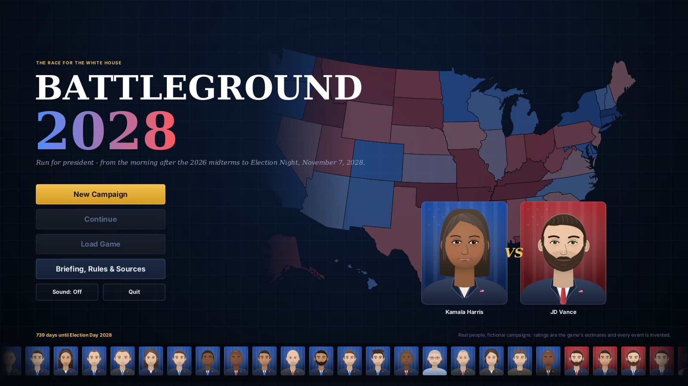
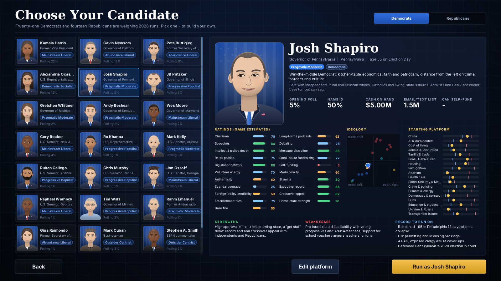
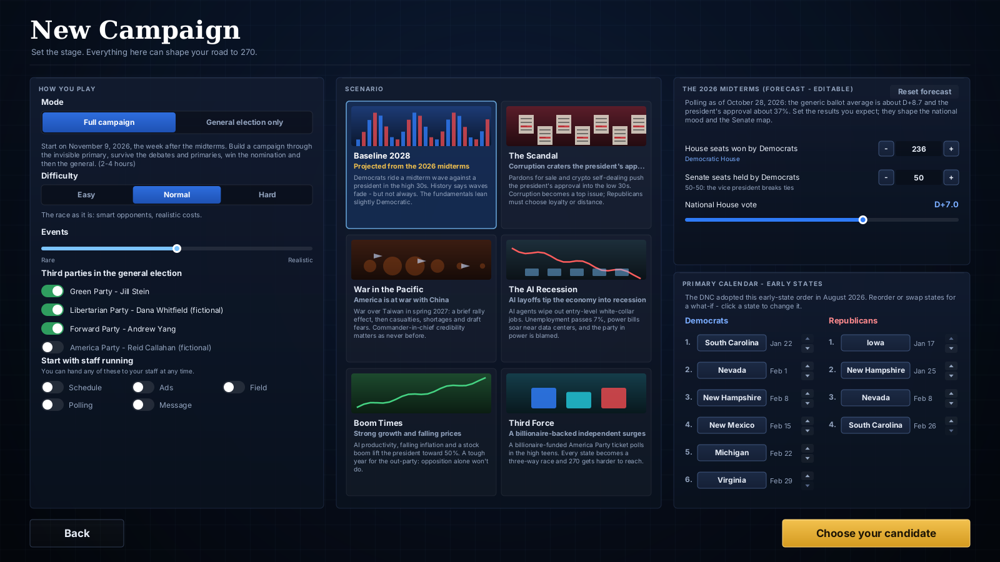
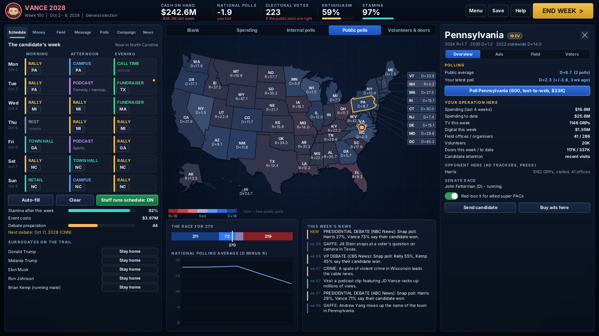
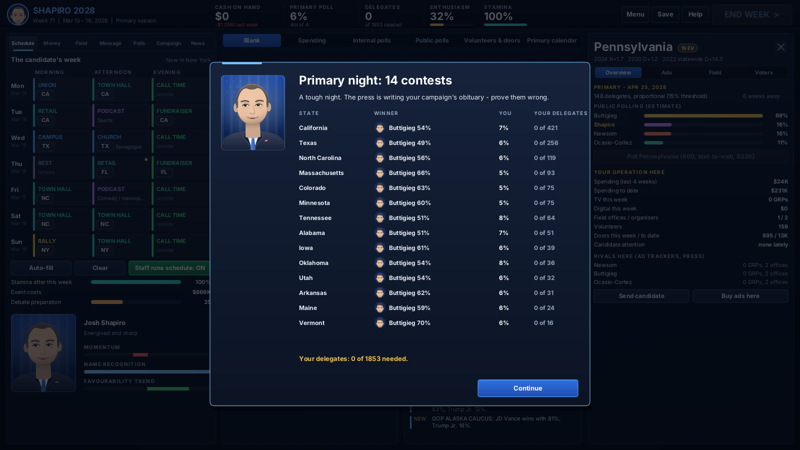
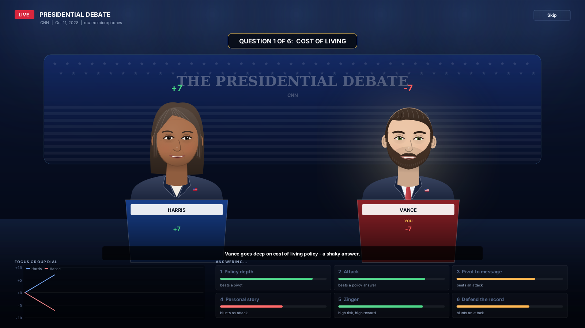
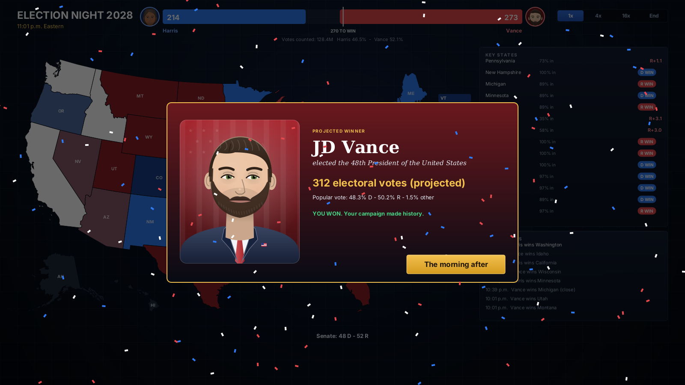

# Battleground 2028

Run for president, from the morning after the 2026 midterms to Election Night, November 7, 2028.

Pick a Democrat or a Republican and run the whole campaign: survive the invisible primary, win delegates, choose a running mate, negotiate and play the debates, and fight for 270 electoral votes. Or skip straight to the general election.



## How to play it

The game is a single Java file. It needs Java 8 or newer and no other libraries.

**In BlueJ**

1. Download this repo (green **Code** button → **Download ZIP**) and unzip it.
2. In BlueJ choose **Project → Open Non BlueJ...** and pick the unzipped folder. (Or make a new project and use **Edit → Add Class from File...** to add `Battleground2028.java`.)
3. Click **Compile**, right-click the `Battleground2028` class and choose **void main(String[] args)**.

**From a terminal**

```
javac Battleground2028.java
java Battleground2028
```

The window scales to your screen. The game autosaves every week to a `.battleground2028` folder in your home directory, and **Continue** on the main menu picks up where you left off. Press **F1** in the game for the full briefing.

## What's in it

- **35 real candidates**: 21 Democrats and 14 Republicans, each with about 20 ratings, plus a governing record, strengths and weaknesses, and a starting platform you can tweak. Ratings include charisma, speeches, long-form podcasts, debating, intellect, fundraising, volunteer energy and home-state pull. Each candidate belongs to an ideological faction that plays differently with different voter groups.
- **Build your own candidate**, either with a point-buy system or in an unlimited "god mode".
- **Third parties** you can switch on: Jill Stein (Green), Andrew Yang (Forward), a fictional Libertarian and a fictional America Party candidate.
- **Scenarios**:
  - A baseline projected from the 2026 midterms, with a forecast you can edit
  - A corruption scandal that craters the president's approval
  - War with China over Taiwan
  - An AI-driven recession
  - An economic boom
  - A billionaire-backed independent surge
- **A weekly schedule** of 7 days × 3 slots: rallies, town halls, retail stops, podcasts, crossover TV, fundraisers, call time and debate prep. Travel and stamina matter.
- **Money**: small-dollar lists, bundlers and donor fatigue, self-funding, allied super PACs, and party money once you're the nominee.
- **Ads**: TV in about 80 media markets at market-based prices, positive, contrast or negative. Digital on Meta, YouTube, streaming and creators.
- **Field**: offices, organizers, volunteers, shifts, doors, calls, texts and relational contacts. The activity ramps up toward Election Day, as it does in real campaigns.
- **Polling**: you choose the sample size and method, and get crosstabs for about 30 voter groups. Public polls come with house effects and a possible shared error.
- **Message and promises**: a weekly frame, attack line and issue focus. Policy promises win over some groups and anger others. They also hurt with your base if they cut against your ideology, though moderation can pay off with swing voters.
- **The issues**: China, AI and data centers, the economy and cost of living, Israel and Gaza, housing, Social Security, immigration, abortion and more. Each issue matters more or less depending on the voter group.
- **Primaries**: the DNC's adopted 2028 early-state calendar, a projected Republican calendar (you can edit both), delegate rules, momentum, dropouts and endorsements.
- **Debates**: you negotiate how many, when and on which networks. Each question is played by choosing an approach, and your debate prep, charisma and intellect decide how well it lands.
- **The map** toggles between a blank map, your spending, your internal polls, the public polls, and your volunteers and doors knocked.
- **Election night**, animated, with the Senate result.

## Screenshots

| | |
|---|---|
|  |  |
|  |  |
|  |  |

## How the simulation works

Each state's electorate is modelled as 96 cells: 16 religious, racial and educational blocs × 3 age groups × 2 sexes. Further layers add urban and rural, union, veteran, gun-owning, LGBTQ, student and parent shares. The cells are calibrated so the model reproduces every state's 2024 result and the national validated-voter and exit-poll numbers for each group. Results from 2020 and 2022 and the 2026 environment shape trends and turnout. Voters weigh 18 issues with group-specific views and intensity. Candidate ratings, the national mood, and every campaign's ads, visits and field work then move each cell.

## Notes

- Candidate ratings are the game's estimates from public records. They are not facts.
- The portraits are stylized caricatures drawn in code.
- Real people, fictional campaigns: nothing in the game quotes a real person, and every event is invented.
- This game is not affiliated with any campaign, party or person.

## Sources

- Election returns: [tonmcg/US_County_Level_Election_Results_08-24](https://github.com/tonmcg/US_County_Level_Election_Results_08-24), [MIT Election Data and Science Lab](https://electionlab.mit.edu/data)
- How groups voted in 2024: [Pew Research Center validated voters](https://www.pewresearch.org/politics/2025/06/26/behind-trumps-2024-victory-a-more-racially-and-ethnically-diverse-voter-coalition/), AP VoteCast, national exit polls
- The 2026 environment: [Silver Bulletin generic ballot](https://www.natesilver.net/p/generic-ballot-average-2026-nate-silver-bulletin-congress-polls) and [presidential approval](https://www.natesilver.net/p/trump-approval-ratings-nate-silver-bulletin) averages (October 2026)
- 2028 Democratic calendar: adopted by the DNC on August 15, 2026 ([Washington Examiner](https://www.washingtonexaminer.com/?p=4685985))
- Map: [us-atlas](https://github.com/topojson/us-atlas) (Census Bureau boundaries)
- TV markets and ad pricing: Nielsen DMA estimates; AdImpact 2024 cycle reporting
